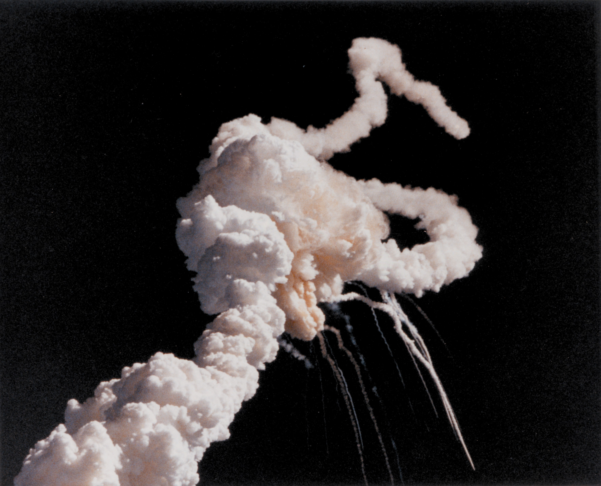
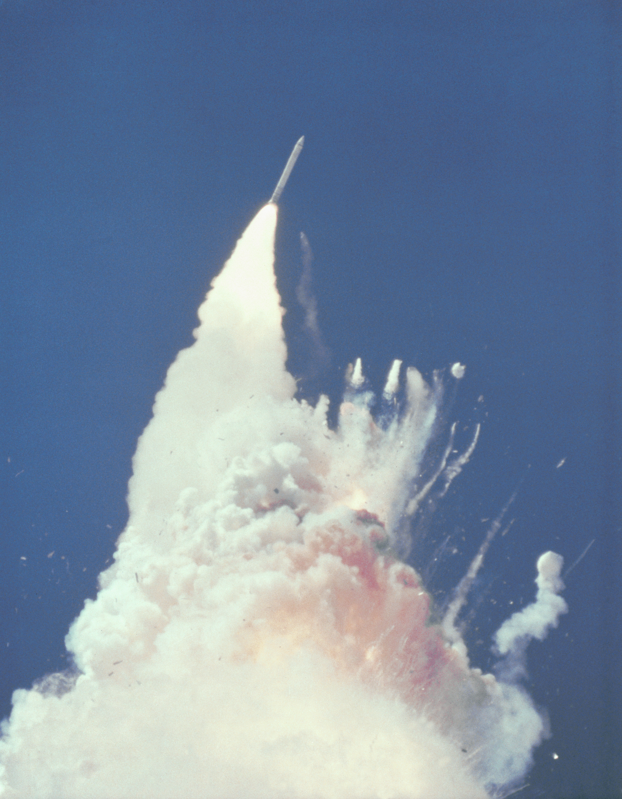
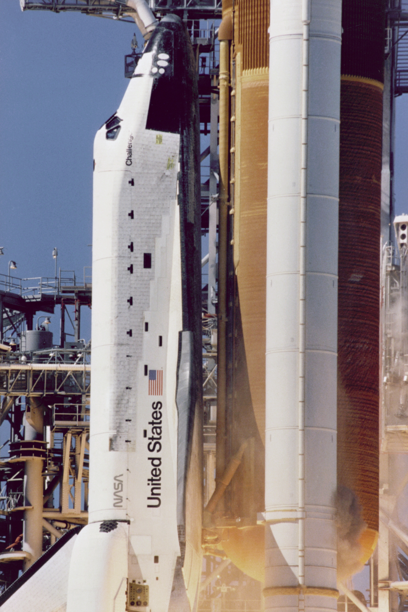
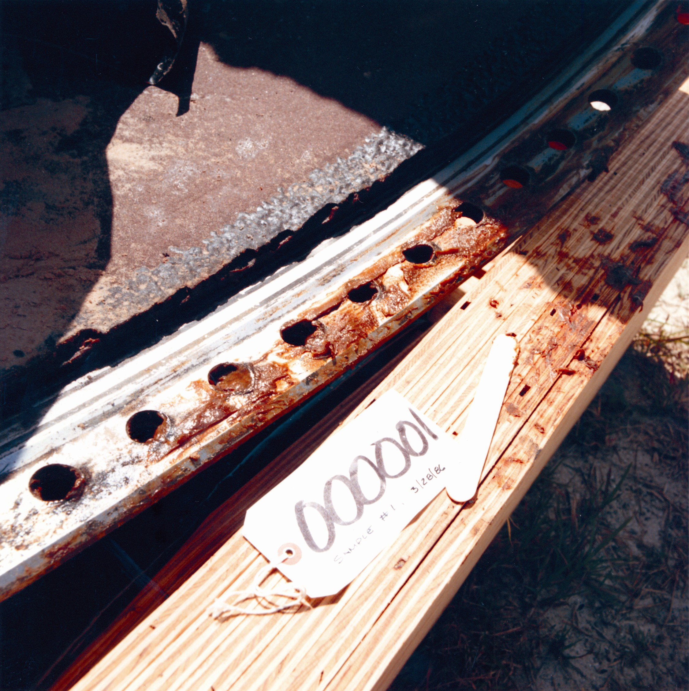
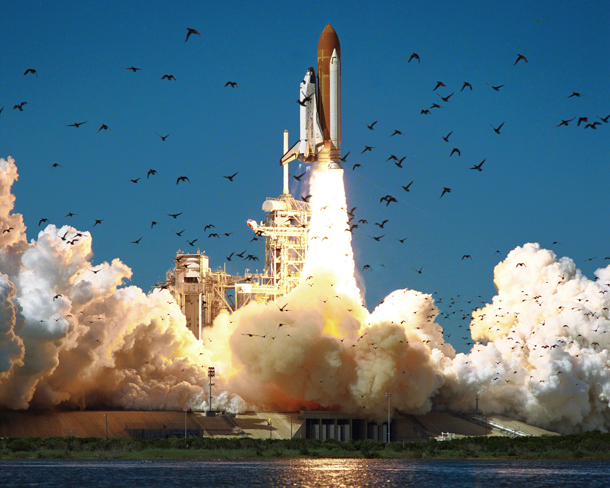
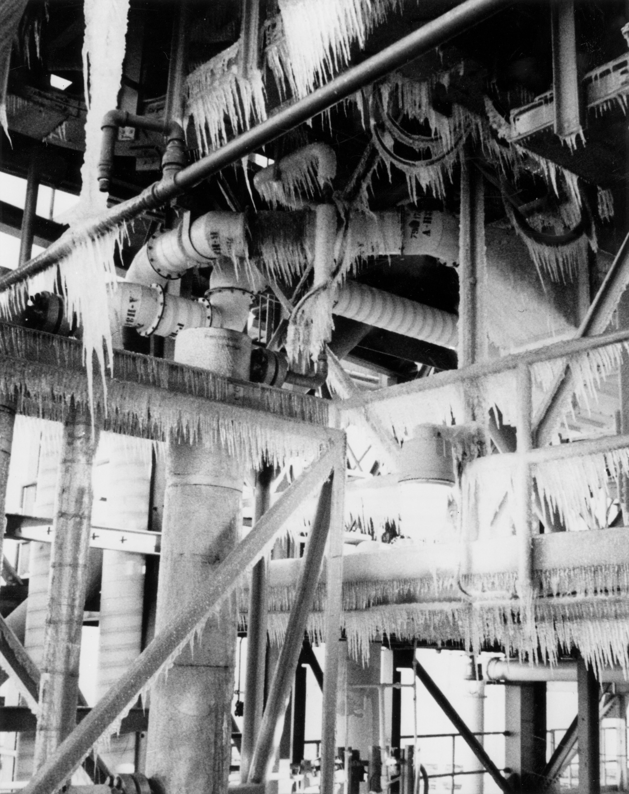
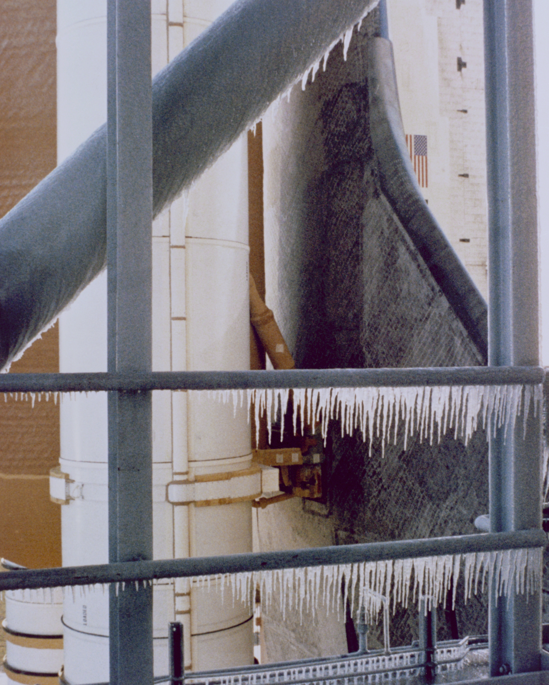
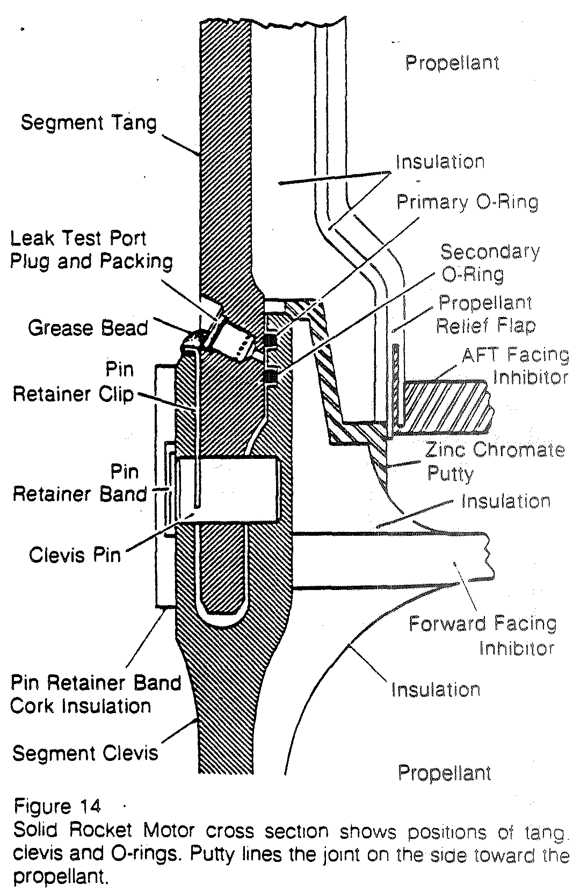
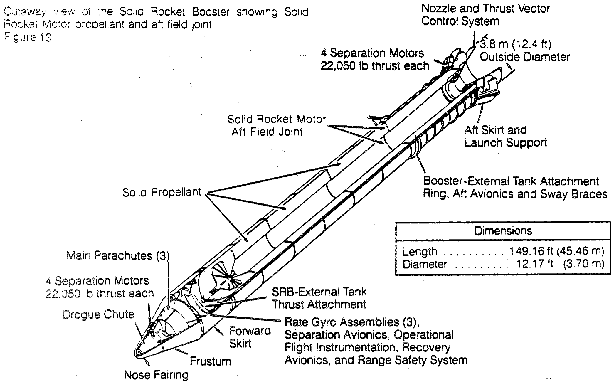
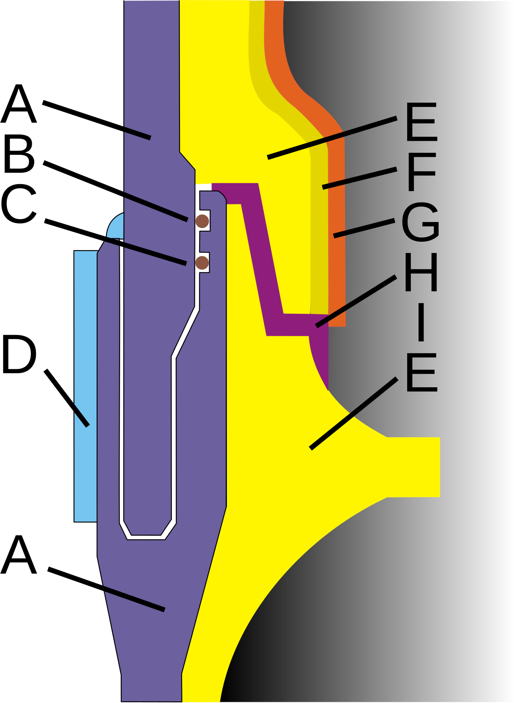

# Media sources — Challenger talk

All NASA material is a work of the US federal government → public domain (no attribution legally required; credit recommended).
Licences checked on each Wikimedia Commons file page (licence template + source/author fields), 2026-10-20.
Rogers Commission report: US government work → public domain.

---

## A. Destruction

### A1. Breakup plume, seconds after — breakup-nasa-1.jpg

- **Source:** https://commons.wikimedia.org/wiki/File:Challenger_explosion.jpg (orig. NASA KSC, https://www.flickr.com/photos/nasa2explore/10697912315/)
- **Author / rights holder:** NASA / Kennedy Space Center
- **Licence:** Public domain (US federal work) · verified on landing page ✓
- **Attribution required:** no (but recommended)
- **Credit line for the slide:** `"Challenger explosion", NASA/KSC, public domain, via Wikimedia Commons`
  - HTML: `<a href="https://commons.wikimedia.org/wiki/File:Challenger_explosion.jpg">Challenger explosion</a>, NASA/KSC, public domain, via Wikimedia Commons`
- **Allowed edits:** crop / resize / recolour / overlay text — ok
- **Red flags:** none (no people; sensitive subject, but nothing graphic)
- **Resolution:** 3555 × 2879 — fits full slide
- **Confidence:** high — NASA KSC photo, PD tag, NASA Flickr source

### A2. Breakup at ~76 s, left SRB flying free — breakup-nasa-2.jpg

- **Source:** https://commons.wikimedia.org/wiki/File:Challenger_Rocket_Booster_-_GPN-2000-001422.jpg (NASA GRIN GPN-2000-001422)
- **Author / rights holder:** NASA
- **Licence:** Public domain · verified on landing page ✓
- **Attribution required:** no (but recommended)
- **Credit line:** `"Challenger Rocket Booster" (GPN-2000-001422), NASA, public domain, via Wikimedia Commons`
- **Allowed edits:** all ok
- **Red flags:** none
- **Resolution:** 2339 × 3000 (portrait) — half slide, or full-height
- **Confidence:** high — NASA Great Images in NASA

### A3. Video: launch and breakup, broadcast footage — launch-breakup-nasa.mp4 (original: .webm)
- **Source:** https://commons.wikimedia.org/wiki/File:Space_Shuttle_Challenger_Launch_and_Breakup.webm
- **Author / rights holder:** NASA STI Program (digitised from a USGS VHS tape)
- **Licence:** Public domain · verified on landing page ✓
- **Attribution required:** no (but recommended)
- **Credit line:** `"Space Shuttle Challenger Launch and Breakup", NASA, public domain, via Wikimedia Commons`
- **Allowed edits:** trim / mute / re-encode — ok (converted to H.264 MP4 for Safari)
- **Red flags:** has sound (launch commentary); breakup at roughly 1:20–1:35, launch ~0:00–0:20 (to fine-tune when building the slide)
- **Resolution:** 1280 × 720, 2 min 50 s, 22 MB as MP4
- **Confidence:** high

## B. O-rings

### B1. Grey smoke at the aft field joint at liftoff — oring-smoke-nasa-1.jpg

- **Source:** https://commons.wikimedia.org/wiki/File:Challenger_-_GPN-2000-001347.jpg (NASA GRIN GPN-2000-001347)
- **Author / rights holder:** NASA
- **Licence:** Public domain · verified on landing page ✓
- **Attribution required:** no (but recommended)
- **Credit line:** `"Challenger" (GPN-2000-001347), NASA, public domain, via Wikimedia Commons`
- **Allowed edits:** all ok — crop/zoom recommended: NASA's caption puts the smoke on the right SRB "directly across from the letter 'U' in United States"; it is small at full frame.
- **Red flags:** none
- **Resolution:** 2308 × 3458 (portrait) — crop to a landscape detail
- **Confidence:** high

### B2. Recovered right-SRB joint with O-ring tracks — oring-debris-nasa-2.jpg

- **Source:** https://commons.wikimedia.org/wiki/File:STS-51-L_Recovered_Debris_(O-Ring_Tracks_on_Right_SRB_Joint)_-_GPN-2004-00010.jpg
- **Author / rights holder:** NASA
- **Licence:** Public domain · verified on landing page ✓
- **Attribution required:** no (but recommended)
- **Credit line:** `"STS-51-L Recovered Debris (O-Ring Tracks on Right SRB Joint)", NASA, public domain, via Wikimedia Commons`
- **Allowed edits:** all ok
- **Red flags:** none
- **Resolution:** 2252 × 2258 — half slide / square
- **Confidence:** high

### B3. Video: tracking camera E-207, plume from the right SRB hitting the tank — camera-e207-nasa.mp4 (original: .webm)
- **Source:** https://commons.wikimedia.org/wiki/File:STS-51L_Challenger_Engineering_Camera_E-207.webm
- **Author / rights holder:** NASA (released via FOIA by Kennedy Space Center)
- **Licence:** Public domain · verified on landing page ✓
- **Attribution required:** no (but recommended)
- **Credit line:** `"STS-51L Challenger Engineering Camera E-207", NASA, public domain, via Wikimedia Commons`
- **Allowed edits:** all ok (converted from AV1 to H.264 MP4)
- **Red flags:** no sound; useful part is ~0:15–0:45, the rest is empty sky
- **Resolution:** 1280 × 720, 3 min 44 s, 28 MB as MP4
- **Confidence:** high

## C. Shuttle on the launch pad

### C1. Challenger lifting off pad 39B, 28 Jan 1986 — pad-launch-nasa-1.jpg

- **Source:** https://commons.wikimedia.org/wiki/File:STS-51-L.jpg (KSC Photo Archive)
- **Author / rights holder:** NASA
- **Licence:** Public domain · verified on landing page ✓
- **Credit line:** `"STS-51-L", NASA/KSC, public domain, via Wikimedia Commons`
- **Allowed edits:** all ok
- **Red flags:** none
- **Resolution:** 3000 × 2400 — fits full slide
- **Confidence:** high

### C2. Ice on the pad the morning of the launch — pad-ice-nasa-2.jpg

- **Source:** https://commons.wikimedia.org/wiki/File:Ice_on_the_Pad_on_the_Day_of_STS-51-L%27s_Launch_-_GPN-2004-00011.jpg
- **Author / rights holder:** NASA
- **Licence:** Public domain · verified on landing page ✓
- **Credit line:** `"Ice on the Pad on the Day of STS-51-L's Launch" (GPN-2004-00011), NASA, public domain, via Wikimedia Commons`
- **Allowed edits:** all ok
- **Red flags:** none
- **Resolution:** 2244 × 2830 (portrait, B&W) — half slide
- **Confidence:** high

### C3. Icicles on the launch tower next to the booster — pad-icicles-nasa-3.jpg

- **Source:** https://commons.wikimedia.org/wiki/File:Icicles_on_the_Launch_Tower_-_GPN-2000-001348.jpg
- **Author / rights holder:** NASA
- **Licence:** Public domain · verified on landing page ✓
- **Credit line:** `"Icicles on the Launch Tower" (GPN-2000-001348), NASA, public domain, via Wikimedia Commons`
- **Allowed edits:** all ok
- **Red flags:** none
- **Resolution:** 2404 × 3000 (portrait) — half slide
- **Confidence:** high

## D. Where the O-rings are and what they do

### D1. Field joint cross-section (Rogers Fig. 14) — joint-diagram-rogers-1.png

- **Source:** Report of the Presidential Commission on the Space Shuttle Challenger Accident, Vol. 1 (1986), Fig. 14, p. 57 — https://ntrs.nasa.gov/citations/19860015255
- **Author / rights holder:** Presidential Commission (US government)
- **Licence:** Public domain (US federal work) — no landing-page licence tag; status follows from authorship
- **Credit line:** `Rogers Commission Report, Vol. 1, Fig. 14 (1986), public domain`
- **Allowed edits:** all ok — cropped from the scanned PDF by Bastien Chevallier; black on white, so invert (CSS `filter: invert(1)`) to sit on the black slides
- **Red flags:** scan quality (soft grey text); labels in English
- **Resolution:** 1080 × 1660 — half slide
- **Confidence:** high

### D2. Cutaway of the booster showing the aft field joint (Rogers Fig. 13) — booster-cutaway-rogers-2.png

- **Source:** same report, Fig. 13, p. 56
- **Licence:** Public domain (US federal work)
- **Credit line:** `Rogers Commission Report, Vol. 1, Fig. 13 (1986), public domain`
- **Allowed edits:** all ok — cropped by Bastien Chevallier; invert for black slides
- **Red flags:** many labels you don't need; best cropped further or used as "where" next to D1 "how"
- **Resolution:** 2091 × 1301 — fits full slide
- **Confidence:** high

### D3. Simplified field-joint section, colour vector — joint-diagram-commons-3.png

- **Source:** https://commons.wikimedia.org/wiki/File:Z%C5%82%C4%85cze_mi%C4%99dzysegmentowe_rakiety_SRB.svg
- **Author / rights holder:** Adam Rędzikowski (vector), after an original by Kapitel
- **Licence:** CC BY-SA 4.0 (https://creativecommons.org/licenses/by-sa/4.0/) · verified on landing page ✓
- **Attribution required:** yes
- **Credit line:** `"Złącze międzysegmentowe rakiety SRB" by Kapitel & Adam Rędzikowski, CC BY-SA 4.0, via Wikimedia Commons`
- **Allowed edits:** ok, but an adapted version must also be CC BY-SA 4.0 (SA)
- **Red flags:** no labels in the image (legend A–I is only in the file description: B = primary O-ring, C = secondary O-ring, H = putty, I = propellant); you'd add your own English labels → adaptation → SA
- **Resolution:** vector (rendered 1280 × 1748) — any size
- **Confidence:** high

## E. Added later

### E1. Challenger's first launch, STS-6, 4 Apr 1983 — shuttle-sts6-launch-2.jpg (on the context slide)
- **Source:** https://commons.wikimedia.org/wiki/File:Space_Shuttle_Challenger_(04-04-1983).JPEG (US DoD, VIRIN DF-SC-84-01865)
- **Licence:** Public domain (US federal work) · verified on landing page ✓
- **Credit line:** `"Space Shuttle Challenger (04-04-1983)", US Department of Defense, public domain, via Wikimedia Commons`
- **Resolution:** 2996 × 2400

### E2. Challenger rolling to the pad through fog, 1982 — shuttle-fog-nasa-1.jpg (unused)
- **Source:** https://commons.wikimedia.org/wiki/File:Space_Shuttle_Challenger_moving_through_fog.jpg (NASA 82pc1325)
- **Licence:** Public domain · verified ✓ · 3055 × 2400

### E3. Debris: "United States" wing panel lowered into a storage silo — debris-silo-nasa-1.jpg (slide 2)
- **Source:** https://commons.wikimedia.org/wiki/File:ChallengerRemains.jpg (NASA GRIN)
- **Licence:** Public domain · verified ✓ · 2018 × 1543
- **Credit line:** `"Challenger remains lowered into storage", NASA, public domain, via Wikimedia Commons`

### E4. Debris hangar — debris-hangar-nasa-2.jpg (unused)
- **Source:** https://commons.wikimedia.org/wiki/File:STS-51-L_Recovered_Debris_(ET_and_SRBs)_-_GPN-2004-00003.jpg · Public domain · 2291 × 2288

### E5. Burn hole in the right booster, seen from inside — debris-burnhole-nasa-3.jpg (unused)
- **Source:** https://commons.wikimedia.org/wiki/File:STS-51-L_Recovered_Debris_(Burn_Marks_on_the_SRM)_-_GPN-2004-00004.jpg · Public domain · 2307 × 2281
